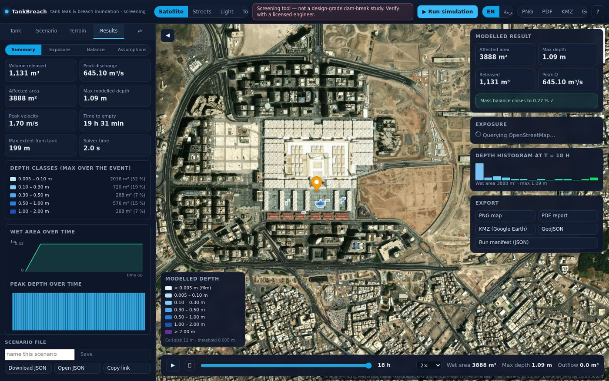
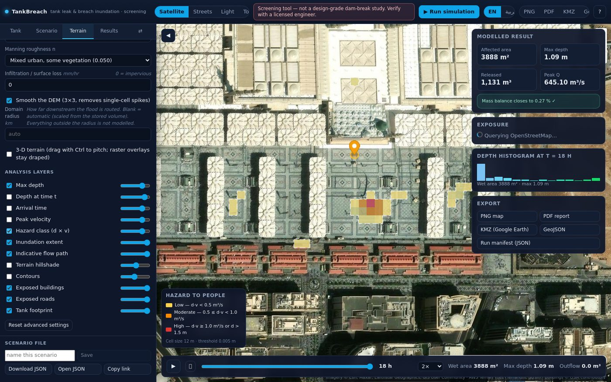
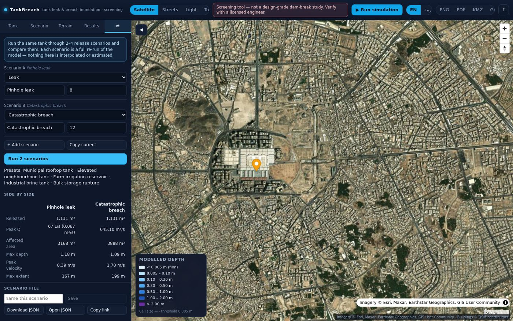
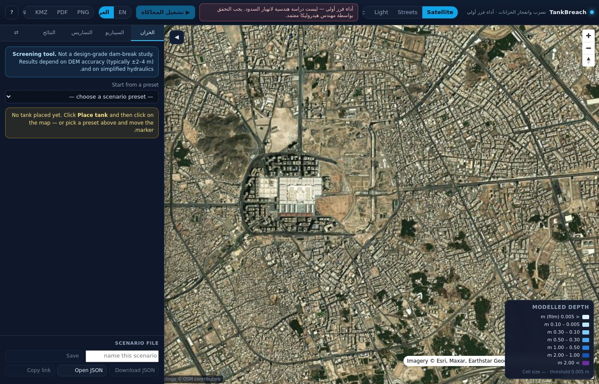
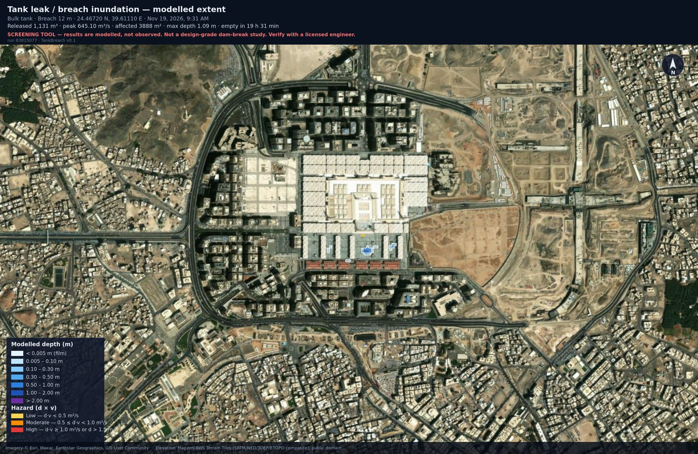
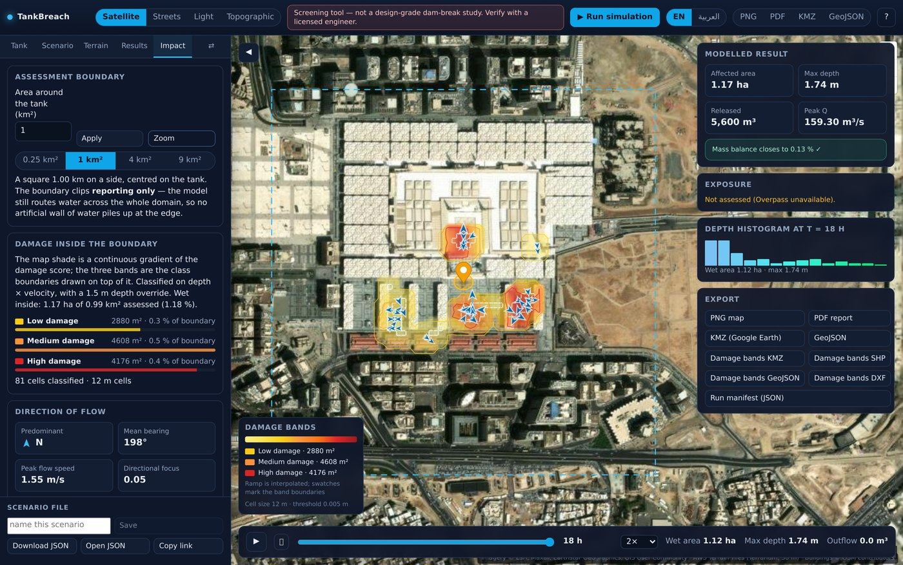
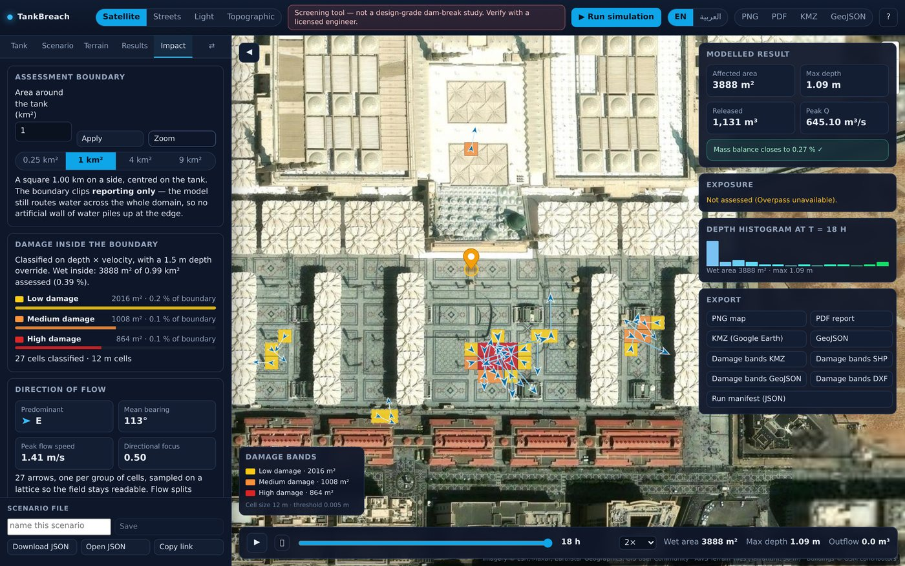

# TankBreach

**Tank leak & breach inundation mapper — screening tool.**

Place a water tank or reservoir on a map, describe how it fails, and see where the water
would go: extent, depth, arrival time, velocity, hazard class and the assets in its path.
Everything runs in your browser. No account, no API key, no server-side data store.



> **This is a screening and awareness tool, not a design-grade dam-break study.** Results
> depend on open DEM accuracy (typically ±2–4 m vertical) and on simplified hydraulics. A
> licensed hydraulic engineer and a field survey must confirm any real-world conclusion.
> Nothing in this tool labels an area "safe" or "unsafe".

---

**New to it?** [`docs/USER-GUIDE.md`](docs/USER-GUIDE.md) walks through every step: placing the
tank, defining the release, running the model, reading the damage bands and arrows, and
exporting.

## Screens

| | |
| --- | --- |
|  |  |
| Hazard layer (`d × v`) over a catastrophic breach | Compare mode: side-by-side table + difference map |
|  |  |
| Arabic interface with full RTL mirroring | Exported 2× PNG with legend, north arrow and disclaimer |



The damage field as a continuous heat map: a 5 000 m³ reservoir breaching onto a built site.
Mass balance 0.13 %, maximum depth 1.74 m, and the arrows show which way the water leaves.



A 1 km² assessment boundary around the tank: low / medium / high damage bands and the
direction-of-flow field, with the band areas and the predominant bearing in the panel.

## Quick start

```bash
npm ci          # exactly the tested versions (needs package-lock.json)
npm run dev     # http://localhost:5173
npm test        # engine + impact + shapefile suite (33 cases)
npm run build   # production bundle in dist/
npm run serve   # serve the production bundle on :4173
```

If `npm ci` complains that there is no `package-lock.json`, use `npm install` instead — some
copies of the project (a zip export, for example) arrive without the lockfile.

Requirements: Node 20.19+ or 22.12+, a browser with WebGL 2 and `OffscreenCanvas` (any current
Chrome/Edge/Firefox/Safari), and outbound HTTPS for the basemap and DEM tiles.

### Dependency versions — read before running `npm audit fix`

The app is built and verified against the versions in `package-lock.json`:

| Package | Pinned | Note |
| --- | --- | --- |
| `vite` | 8.3.8 | Node 20.19+ / 22.12+ |
| `@vitejs/plugin-react` | 6.3.0 | must match the Vite major |
| `maplibre-gl` | 6.19.0 | ≥6.16 has the sanitizer XSS fix; 6 dropped the default export, so `MapView.tsx` imports `* as maplibre-gl` |
| `react` / `react-dom` | 18.3.1 | |
| `vitest` | 4.x | |

`npm audit` is clean as of these versions. If you bump a major, re-run the whole gate
(`tsc` → `vitest` → `npm run build` → a real browser run); a green typecheck is not enough.
Two failures found this way during the 5 → 6 / 5 → 8 upgrades are worth remembering:

* MapLibre 6's tile worker fails to load if Vite pre-bundles the package — hence
  `optimizeDeps.exclude: ["maplibre-gl"]` in `vite.config.ts`. The symptom is
  *"Worker failed to load. Check that the worker URL is correct"* and a basemap that never appears.
* MapLibre 6 has **no default export**; `import maplibregl from "maplibre-gl"` throws at runtime
  under ESM even though older toolchains let it slide. Use `import * as maplibregl`.

### Docker

```bash
docker build -t tankbreach .
docker run --rm -p 8080:80 tankbreach     # http://localhost:8080
```

The image is a two-stage build (Node builds the bundle, nginx serves it). No runtime backend
is required.

---

## What it actually computes

### Stage A — the release hydrograph (`src/engine/hydrograph.ts`)

| Mode | Law | Notes |
| --- | --- | --- |
| Leak / partial breach | `Q = Cd · A · √(2gh)` | Orifice with a falling head. The head is recomputed from the released volume through an exact inversion of the tank's storage curve, so there is no drift. |
| Catastrophic breach, overtopping | `Q = Cw · b · H^1.5` | Broad-crested weir (`Cw ≈ 1.7` in SI, user-editable via the breaker width/coefficient). `H` = head above the breach invert. |

Supported tank shapes: vertical cylinder, horizontal cylinder, rectangular box, sphere
(part-filled). Capacity is either computed from the dimensions or typed in; a mismatch is
reported, never silently applied. A user-specified release duration or release fraction
truncates the hydrograph.

The discharge is sampled at ≤ 1 s for the first two minutes (when a breach peaks) and more
coarsely afterwards, so the router never sees a step change in inflow.

### Stage B — 2-D routing (`src/engine/shallowFlow.ts`)

* Inertial-form shallow-water equations (Bates, Horritt & Fewtrell 2010) on a uniform metric
  grid (default 12 m, auto-coarsened to respect the cell budget).
* CFL-controlled adaptive time step, separately tightened at wetting fronts.
* Manning friction with presets (concrete 0.013 → scrub 0.12).
* Flux limiter: a cell can never give away more water than it holds, and a face carries one
  flux shared by both of its cells — so the scheme cannot create or destroy volume.
* Froude-1.0 cap on the donor depth plus a 12 m/s velocity ceiling; peak velocity is reported
  from *outgoing* faces only.
* All four domain edges are open outfalls and everything that crosses them is booked as
  boundary outflow.
* Optional constant infiltration (mm/hr), tracked as a separate loss.

### Mandatory mass balance

Every run reports `released = stored + boundary outflow + infiltration ± error`, with a
1 % tolerance. The banner turns amber when it is exceeded and the run is flagged in every
export. In the validation suite the balance closes to **< 0.5 %** on a flat plane, on a 2 %
slope with outflow, and with infiltration.

### Impact boundary, damage bands and flow direction (`src/analysis/`)

A user-defined **assessment boundary** (a square area around the tank — 0.25, 1, 4 or 9 km²,
or any number you type) reports the result in three damage classes and a flow-direction field.

**Heat map.** The map shade is a *continuous* gradient of the damage score — pale yellow at the
outer rim, orange through the middle, deep red where the loading is highest — painted from a
blurred score field with linear resampling. The three bands are drawn on top as crisp iso-lines,
so you get both "where is it worst" and "which class is this". (An earlier version drew one
rectangle per classified cell; at 12 m cells that is a handful of isolated blobs, which is not a
map.)

**Three bands.** Every cell inside the boundary that holds water is classified:

| Band | Rule |
| --- | --- |
| **Low** | wet, but below both the medium depth and medium depth × velocity thresholds |
| **Medium** | depth ≥ 0.10 m **or** depth × velocity ≥ 0.5 m²/s |
| **High** | depth ≥ 0.50 m **or** depth × velocity ≥ 1.0 m²/s **or** depth ≥ 1.5 m |

Depth alone decides when the flow is too slow for velocity to be meaningful. The analysis
picks the method automatically (depth × velocity when more than 5 % of wet cells move faster
than 0.3 m/s, depth-only otherwise) and **says which one it used** — in the panel, the legend
and every export.

**Flow direction.** Per wet cell, the net transport direction comes from the gradient of the
water surface (depth + bed elevation), which is what actually drove the water there. Cells are
thinned onto a lattice so at most ~220 arrows are drawn, each carrying a bearing, a speed and
a depth × velocity flux. The panel reports the **predominant compass sector**, the
area × depth-weighted **mean bearing**, and a **concentration** (0–1) that tells you whether
one front dominates or the flow splits.

**The boundary clips reporting, not physics.** The solver always routes water across the whole
domain. If you ask for a boundary larger than the modelled domain, the app says so and reports
the *assessed* area separately — area that was never simulated is never presented as unaffected.

Recomputing for a new boundary is a pure post-process over the finished rasters, so it is
instant: the solver is not re-run.

### Hazard

`depth × velocity` with a `depth > 1.5 m` override, using the DEFRA/EA-style 0.5 and
1.0 m²/s bands. Colour ramps are colour-blind safe and never use "safe/unsafe" wording.

---

## Data sources and licences

| Layer | Source | Licence |
| --- | --- | --- |
| Satellite basemap (default) | Esri World Imagery | Esri / Maxar / Earthstar Geographics — © Esri and contributors |
| Streets / Topographic | Esri World Street Map, World Topo Map | © Esri and contributors |
| Light | CARTO Positron | © CARTO, © OpenStreetMap contributors (ODbL) |
| Elevation (default) | AWS Terrain Tiles (Mapzen terrarium, SRTM/NED/3DEP composite) | Public domain / CC0 |
| Elevation (alternative) | Copernicus DEM GLO-30 (AWS Open Data) | © DLR e.V. / ESA / Airbus, Copernicus DEM free licence |
| Elevation (user) | Your own GeoTIFF, dropped onto the Terrain tab | Yours |
| Buildings & roads | OpenStreetMap via Overpass API | © OpenStreetMap contributors, ODbL |
| Google satellite | **not bundled** | Requires your own key; see `.env.example` |

No Google tiles are scraped, cached or bundled. If you supply a Google Maps API key through
`VITE_GOOGLE_MAPS_API_KEY` the key is used directly in the browser and remains yours — and
you become responsible for Google's terms of use. The build works fully without it.

### DEM caveat — DSM vs DTM

The default terrarium composite mixes SRTM/NED/3DEP, i.e. a *surface* model: it includes
buildings and tree canopy in places. On a dense urban block the ground is often 2–10 m below
the modelled surface, which biases ponding. Use a bare-earth DTM (or your own survey) when
depths matter. The Terrain tab shows the source, resolution, nominal accuracy and DSM/DTM
nature of whatever is loaded.

### Copernicus GLO-30 in the browser

The public Copernicus bucket does not send `Access-Control-Allow-Origin`, so COG range reads
from a browser are blocked by CORS. The app detects this, says so plainly, and falls back to
the terrain-tile source. To use GLO-30, either upload a GeoTIFF or proxy the COG through your
own server (see "Optional backend" below).

---

## Using the app

| Area | What it does |
| --- | --- |
| **Tank tab** | Place a tank (click the map or drag the marker), edit dimensions, water level, capacity, base elevation (auto-sampled from the DEM, never silently overwritten), shape, nameplate-vs-geometry mismatch warning, and five seed scenarios. |
| **Scenario tab** | Release mode, hole shape and size (10–250 mm presets), breach width, development time, Cd, duration or "until empty", release fraction, Manning `n`, infiltration, routing cap, domain radius, and a live `Q(t)` preview computed from the current inputs. |
| **Terrain tab** | DEM source, cell size, DEM smoothing, 3-D terrain with exaggeration, layer visibility and opacity for all 12 layers. |
| **Results tab** | Metrics, depth-class table, mass balance, exposure, assumptions, warnings, and the export buttons. |
| **Compare tab** | Run 2–4 release scenarios through the same worker, side-by-side table plus a signed depth-difference map. |
| **Timeline** | Play/pause, frame scrubber, speed, and live depth histogram. `Space` toggles playback, `←`/`→` step frames. |

Other features: save/load scenarios in this browser, download/upload a scenario JSON, copy a
shareable permalink (`#s=…`, inputs only — results are always recomputed), EN/العربية with full
RTL mirroring, exponential/layer controls, coordinate readout, scale bar, north arrow.

### Exports

| Format | Contents |
| --- | --- |
| **PNG** | 2× map composite with title block, legend, north arrow, scale, timestamp, run hash, attribution and the disclaimer. |
| **PDF** | 3 A4 pages (jsPDF): specifications and map; depth classes, hazard, exposure, `Q(t)`/`V(t)` charts, mass balance; DEM provenance, assumptions, limitations, full run manifest. Footers carry the run hash and page numbers. |
| **KMZ** | `doc.kml` with the tank and breach placemarks (ExtendedData), depth and hazard GroundOverlays, arrival overlay, class-area folder, exposed-building placemarks, a legend ScreenOverlay, and an optional bundled report. Opens in Google Earth. |
| **GeoJSON** | Per-cell polygons with `max_depth_m`, `arrival_s`, `peak_velocity_ms`, `depth_class`, `hazard_class`, plus building points and run metadata. |
| **Damage-band KMZ** | One folder per band (16 placemarks, ExtendedData carrying the class and area), the flow arrows as placemarks, the boundary, and a legend card as a ScreenOverlay. Opens in Google Earth with the colours already keyed. |
| **Damage-band SHP** | A real zipped ESRI shapefile set — `damage_bands`, `flow_direction` and `boundary`, each with `.shp`/`.shx`/`.dbf`/`.prj`/`.cpg` in WGS84, plus a README. Written byte-by-byte in `src/export/vectors.ts` (no GIS dependency); the writer is round-trip tested. |
| **Damage-band GeoJSON** | Band polygons (row-merged), the boundary, the arrows and a flow summary feature, with `damage_areaKm2` and cell counts in the metadata. |
| **Damage-band DXF** | `DAMAGE_LOW` / `DAMAGE_MEDIUM` / `DAMAGE_HIGH` / `FLOW` / `BOUNDARY` layers for CAD. |
| **Manifest JSON** | Full input/output provenance: tank, scenario, options, DEM, grid, results, classes, warnings. |

Every export carries the screening-tool disclaimer and the run hash.

---

## Validation

`npm test` runs 33 cases, including:

* analytic Torricelli emptying time within 10 %;
* release never exceeds the stored volume;
* larger opening → larger peak discharge;
* mass balance within 1 % on a flat plane, on a 2 % slope with outflow, and with infiltration;
* no uphill flow (wet centroid is downstream of the tank);
* water accumulates in a closed bowl instead of vanishing;
* arrival times increase with distance downstream;
* every wet cell falls in exactly one depth class, and class areas sum to the reported area;
* determinism: identical inputs → identical FNV-1a run hash;
* DEM plane preservation and automatic coarsening under the cell budget;
* damage bands stay ordered low → high, never classify cells outside the boundary, and a
  larger boundary never reports less classified area;
* the heat-map contours close into rings (no open arcs), nest strictly (high ⊆ medium ⊆ low),
  and the outer contour is within 25 % of the wet-cell footprint;
* a cell that receives water for the first time in a step is integrated in that step — a
  regression test for the silent water loss that showed up as a 19 % mass-balance error;
* the depth-only fallback triggers when nothing moves, and the 1.5 m override still forces
  "high";
* an eastward water-surface gradient reports "E";
* the arrow count stays bounded and every emitted arrow has a finite lon/lat and a bearing
  in [0, 360);
* the shapefile writer round-trips: `.shp` file code, declared length, shape type, ring
  coordinates and bbox all parse back; the `.shx` offsets point at real records; the `.dbf`
  header counts, field padding and terminators are correct.

### Known limitations

* No shock capturing, no hydraulic jump, no vertical jet impact.
* No storm-drain network, culverts, walls, or building blockage (buildings are not obstacles
  by default).
* No sediment, erosion, evaporation or soil physics.
* DEM vertical error is **not** propagated — treat absolute depths as ± the DEM accuracy.
* Uniform roughness; no land-cover variation.
* Overpass (building/road exposure) is often rate-limited or unreachable. The app then reports
  **"not assessed"**, which explicitly does *not* mean "no assets affected", and never blocks
  the run.

---

## Optional backend

The app is client-first and has no runtime backend. If you need server-side processing
(large domains, GLO-30 COG proxying, Overpass caching, batch runs), a small FastAPI service is
the intended path:

```
POST /api/simulate   { tank, scenario, options }  -> result payload (same schema as the worker)
GET  /api/dem/glo30?bbox=...                       -> GeoTIFF slice (server-side COG range read)
GET  /api/exposure?bbox=...                        -> cached OSM extraction
```

The worker's message contract (`src/workers/simulate.worker.ts`) is intentionally identical to
what such an endpoint would return, so swapping transport is a small change. Nothing in this
repository requires that service to exist.

---

## Project layout

```
src/
  engine/      hydrograph.ts · shallowFlow.ts · grid.ts · geo.ts · exposure.ts · types.ts
  analysis/    impact.ts (assessment boundary · damage bands · flow-direction field)
  providers/   dem.ts (terrarium + GLO-30 + user GeoTIFF) · basemaps.ts (Esri/CARTO + Overpass/geocode)
  workers/     simulate.worker.ts (fetch DEM → grid → hydrograph → route → classify)
  components/  MapView.tsx · Panels.tsx · Charts.tsx · Compare.tsx
  export/      png.ts · pdf.ts · kml.ts · geojson.ts · vectors.ts (KMZ/SHP/DXF/GeoJSON)
               · legend.ts (band legend card embedded in the KMZ and reports)
  test/        engine.test.ts · preset.test.ts · impact.test.ts
  store.ts     Zustand store · i18n.ts · persist.ts · format.ts
```

Rendering: MapLibre GL JS raster layers are built from the typed-array result on the main
thread; the solver never touches the DOM. Depth frames are transferred zero-copy as
`ArrayBuffer`s.

---

## Licence

Code: MIT. Data: see the table above; each layer keeps its own licence and attribution, and
every export carries it.
